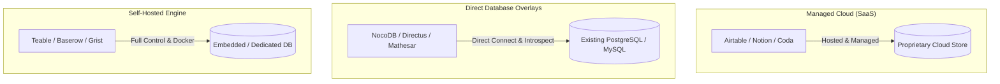

# Awesome Collaborative Relational Database Tables

  

  
  
  
  
  

> 🚀 A curated list of collaborative relational databases, no-code spreadsheet-database hybrids, real-time table workspaces, and self-hosted Airtable alternatives for teams, developers, and citizen builders.

Collaborative relational databases combine the familiar flexibility of a spreadsheet with the structural integrity, linked records, and querying power of a relational database. They empower cross-functional teams to build custom workflows, manage relational datasets, run automations, and collaborate in real time without writing SQL or managing server infrastructure. 📊⚡

---

## 📑 Table of Contents

- [🌐 Sector Overview & Market Dynamics](#-sector-overview--market-dynamics)
- [☁️ SaaS & Hosted Platforms](#️-saas--hosted-platforms)
- [💻 Open-Source GitHub Projects](#-open-source-github-projects)
- [🏗️ Architecture & Deployment Patterns](#️-architecture--deployment-patterns)
- [🧭 How to Choose](#-how-to-choose)
- [🤝 How to Contribute](#-how-to-contribute)
- [💖 Support](#-support)
- [⭐ Star History](#-star-history)
- [📜 License & Disclaimer](#-license--disclaimer)

---

## 🌐 Sector Overview & Market Dynamics

The collaborative relational database and no-code data workspace market intersects the **$70B+ relational DBMS market** and the **$25B+ low-code/no-code application platform market**, expanding at an estimated CAGR of over **22%**. 📈

The sector is **moderately fragmented**: mega-cap ecosystem providers (Microsoft Lists, Notion, Airtable) capture enterprise distribution and general workspace collaboration, while specialized challenger platforms and self-hosted open-source alternatives (NocoDB, Directus, Baserow) dominate data sovereignty, custom database frontends, and developer-centric use cases rather than devolving into a winner-take-all outcome. 🧩

---

## ☁️ SaaS & Hosted Platforms

*Commercial cloud platforms offering managed hosting, enterprise compliance, and native collaborative features. Sorted by company scale (valuation / market capitalization, descending).* 🏢

| Product | Scale (Valuation / Revenue) | Description | Pricing (Starting Paid Tier) | Free Tier / Trial Limits |
|:---|:---|:---|:---|:---|
| **[Microsoft Lists](https://www.microsoft.com/en-us/microsoft-365/microsoft-lists)** | **$3.8T+ Market Cap** | Relational list and lightweight database app deeply integrated into Microsoft 365, Teams, and SharePoint ecosystems. | **$7.00/user/month** (via Microsoft 365 Business Basic, annual commitment) | **Free Forever (MSA Preview)**: Capped at 50 lists per account, 2,000 items per list, and 200 MB storage per list via personal Microsoft Account. |
| **[Zoho Tables](https://www.zoho.com/tables/)** | **$12B+ Implied Valuation** (~$1.4B ARR) | Relational database workspace within the Zoho suite, supporting linked tables, forms, views, and workflow triggers. | **$4/user/month** (annual commitment, starts at 3 licenses; also included in Zoho One) | **Free Forever**: Capped at 3 viewers, 1 workspace, 5 bases, 5,000 records per base, 5 GB storage, and 3 automations per base. |
| **[Notion Databases](https://www.notion.so/)** | **$11B Valuation** (~$600M+ ARR) | Flexible, page-embedded relational databases with two-way relations, rollups, formula properties, and multiple layout views. | **$10/user/month** (Plus plan, annual commitment; or $12/month billed monthly) | **Free Forever**: Unlimited pages and blocks for individuals, up to 10 guests, 5 MB file upload limit, and 7-day page history. |
| **[Coda](https://coda.io/)** | **$2.3B Valuation** (Private) | Interactive canvas blending documents, relational tables, programmable buttons, custom packs, and real-time automations. | **$10/month per Doc Maker** (Pro plan, annual commitment; Editors & Viewers free) | **Free Forever**: Unlimited unshared docs, 1 GB file storage per doc, up to 50 objects per doc, and 7-day version history. |
| **[Airtable](https://airtable.com/)** | **$1.3B Valuation / Sale** (~$480M ARR) | The pioneering spreadsheet-database hybrid featuring grid, Kanban, calendar, gallery, and Gantt views with built-in app building. | **$20/user/month** (Team plan, annual commitment; or $24/user/month monthly) | **Free Forever**: Up to 5 editors, unlimited bases, 1,000 records per base, 1 GB attachments, 500 AI credits/seat/month, and 100 automation runs/month. 14-day free trial on paid tiers. |
| **[Quickbase (Pave)](https://www.quickbase.com/)** | **$1B+ Private Buyout** (~$200M ARR) | Enterprise low-code relational application platform featuring Pave for AI-powered data modeling and dynamic workflow generation. | **$20/month** (Pave Team plan for up to 10 users; Core Quickbase starts at $35/user/month) | **Free Forever (Pave)**: 1 app, 1 builder, up to 3 collaborative users, and 100 starter runtime credits. |
| **[SmartSuite](https://www.smartsuite.com/)** | **$150M+ Est. Valuation** (~$3M+ ARR) | Modern collaborative work management system with relational data fields, 200+ industry templates, and granular access controls. | **$15/user/month** (Team plan, annual commitment; 3-user minimum required) | **14-Day Free Trial**: Full access to Professional tier features without credit card required. Free guest viewing and commenting. |
| **[SeaTable Cloud](https://seatable.io/)** | **Bootstrapped / ~$4M ARR** (Private) | GDPR-compliant European spreadsheet-database hybrid supporting rich data types, Python/JS scripts, and native automations. | **€7/user/month** (~$7.60/user/month, Plus plan, annual commitment) | **Free Forever**: Up to 25 users, unlimited bases/tables, 10,000 rows total, 2 GB file storage, 1-month snapshot history, 100 automations, and 100 Python executions. |

---

## 💻 Open-Source GitHub Projects

*Self-hostable, open-source relational databases and collaborative table tools for teams prioritizing data sovereignty, on-premises compliance, and no per-user software licensing. Sorted by GitHub_Stars (descending).* 🌟

| Project | Stars_Badge | Description | Primary Stack | License |
|:---|:---|:---|:---|:---|
| **[NocoDB](https://github.com/nocodb/nocodb)** |  | Open-source Airtable alternative that turns any existing SQL database (PostgreSQL, MySQL, SQLite, SQL Server) into a smart collaborative spreadsheet with real-time sync, views, and REST APIs. | Node.js / Vue / TypeScript | AGPL-3.0 |
| **[Directus](https://github.com/directus/directus)** |  | Open-source data platform that wraps any SQL database with a real-time collaborative data studio, granular role-based permissions, automated REST & GraphQL APIs, and custom flows. | TypeScript / Vue / Node.js | BSL 1.1 / GPLv3 |
| **[Teable](https://github.com/teableio/teable)** |  | Next-generation no-code database built natively on PostgreSQL. Delivers true SQL performance, real-time multi-user collaboration, spreadsheet-like formulas, and sub-second rendering for millions of rows. | TypeScript / PostgreSQL / React | AGPL-3.0 |
| **[Grist](https://github.com/gristlabs/grist-core)** |  | Relational spreadsheet-database hybrid powered by full Python formulas, drag-and-drop custom dashboard layouts, granular cell-level permissions, and complete offline/self-hosting capabilities. | Python / TypeScript / SQLite | Apache-2.0 |
| **[Rowy](https://github.com/rowyio/rowy)** |  | Open-source low-code collaborative spreadsheet interface for Firestore and PostgreSQL, featuring cloud functions written directly in the browser, ready-made extensions, and automated workflows. | TypeScript / React / Node.js | Apache-2.0 |
| **[Baserow](https://github.com/bram2w/baserow)** |  | Open-source no-code database and Airtable alternative with unlimited rows on self-hosted instances, visual application builder, AI field prompts, webhooks, and enterprise SSO/RBAC. | Python / Django / Nuxt.js | MIT |
| **[Mathesar](https://github.com/mathesar-foundation/mathesar)** |  | Intuitive open-source spreadsheet-like web interface built directly on top of existing PostgreSQL databases, allowing non-technical users to build schema, alter tables, and generate relational queries. | Python / Django / Svelte | GPL-3.0 |
| **[SeaTable](https://github.com/seatable/seatable)** |  | Self-hosted collaborative table platform with Python & JavaScript script runner, visual database plugins, relational linking, webhooks, and fine-grained data permissions. | Python / C++ / React | Community Edition |

---

## 🏗️ Architecture & Deployment Patterns

When building or adopting collaborative relational database systems, organizations typically deploy across three main architectures: 📐

1. **Direct Database Overlays (NocoDB, Directus, Mathesar)**: Connect straight to your production or replica PostgreSQL/MySQL database. Zero data lock-in and immediate spreadsheet GUI over legacy schemas. ⚡
2. **Dedicated Self-Hosted Platforms (Baserow, Teable, Grist)**: Deploy as standalone Docker containers with turnkey user management, real-time collaboration engines, and built-in automation. 🐳
3. **Fully Managed SaaS (Airtable, Notion, SmartSuite)**: Best for non-engineering teams wanting zero infrastructure overhead, turnkey AI integrations, and instant template ecosystems. ☁️

---

## 🧭 How to Choose

- 🎯 **Need an open-source Airtable alternative with maximum GitHub_Stars & SQL connectivity?** → [NocoDB](https://github.com/nocodb/nocodb) or [Directus](https://github.com/directus/directus).
- 🚀 **Need genuine PostgreSQL performance with millions of rows?** → [Teable](https://github.com/teableio/teable).
- 🐍 **Need Python formulas inside a spreadsheet-database hybrid?** → [Grist](https://github.com/gristlabs/grist-core).
- 🧱 **Need an open-source visual web app builder connected to tables?** → [Baserow](https://github.com/bram2w/baserow).
- 🏢 **Need enterprise Microsoft 365 security & governance?** → [Microsoft Lists](https://www.microsoft.com/en-us/microsoft-365/microsoft-lists).
- 📝 **Need doc-centric collaborative tables and interactive buttons?** → [Coda](https://coda.io/) or [Notion](https://www.notion.so/).

---

## 🤝 How to Contribute

Contributions are warmly welcome! 🙌 To add or update an entry:

1. 🍴 Fork this repository.
2. 📝 Add or update the platform in `README.md` following the standard table structure:
   - Include exact starting pricing and exact free tier limits.
   - For open-source tools, include the official Stars_Badge format (``).
3. 🔢 Ensure the project is properly sorted according to the table guidelines.
4. 🚀 Submit a pull request with a concise description of your changes.

---

## 💖 Support

Thank you so much for exploring this curated repository! If you find this directory valuable for your projects, architecture planning, or stack evaluations, please consider supporting the project:

- ⭐ **Star this repository** to help others discover it on GitHub.
- 🍴 **Fork and share** it with your developer community, colleagues, and team members.
- ☕ **Buy me a coffee / Sponsor**: If you'd like to support ongoing curation and maintenance of open-source knowledge bases, please check out the [GitHub Sponsors Dashboard](https://github.com/sponsors/ishandutta2007).

Your support is deeply appreciated! ✨

---

## 📈 Star History

---

## 📜 License & Disclaimer

- Distributed under the [MIT License](LICENSE). ⚖️
- This list is community-curated for informational purposes. Pricing, limits, and product terms are subject to change by respective vendors. Verify specific quota requirements directly with official providers prior to production rollout. 🛡️
